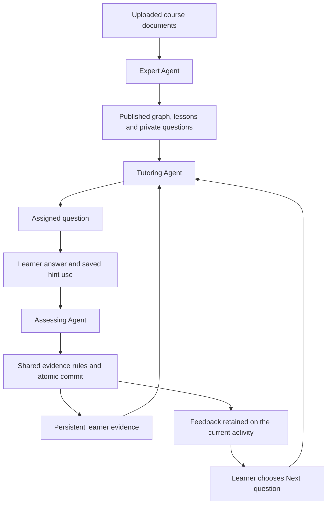

# Three-agent architecture and class demonstration

Current local setup uses SQLite and sqlite-vec; see [SQLite development](sqlite-development.md). Jobs run sequentially with an OS file lock, and write sessions use `BEGIN IMMEDIATE`. PostgreSQL-specific commands and older validation results below describe the legacy adapter/history. Ordinary integration tests now run in temporary SQLite files without opt-in.


This guide connects the current implementation to Section 4 and Appendices A/B of the [LearnLoop proposal source](../../proposal/source/LearnLoop_NeurIPS_2026_r8/LearnLoop_Proposal_r8.tex). The [course guideline](../../proposal/references/guidelines/COMP7608B_LLM_Project_Guideline.md) calls for a working, multi-step agentic application with tools, state, evaluation, and a discussion of limitations.

## The three agent identities

| Proposal name | Python package and entry point | Prompt configuration | Durable workflow ID | Interface label |
| --- | --- | --- | --- | --- |
| Expert Agent | [`agents/expert/agent.py: run`](../learnloop/agents/expert/agent.py) | [`expert/prompts.py`](../learnloop/agents/expert/prompts.py) | `course_preparation` | Expert |
| Tutoring Agent | [`agents/tutoring/agent.py: run`](../learnloop/agents/tutoring/agent.py) | [`tutoring/prompts.py`](../learnloop/agents/tutoring/prompts.py) | `next_activity` | Tutor |
| Assessing Agent | [`agents/assessing/agent.py: run`](../learnloop/agents/assessing/agent.py) | [`assessing/prompts.py`](../learnloop/agents/assessing/prompts.py) | `assessment` | Reviewer |

These are three application roles using the shared model client, each with separate task context and prompts. They need not use three different models or processes. Existing API names, run IDs, role IDs (`expert`, `tutoring`, `assessing`), and saved data remain unchanged.

```text
learnloop/
  api/
    app.py                 # Application factory and HTTP middleware
    dependencies.py        # Shared ownership checks and session projection
    routes/                # Health, courses, documents, sessions, assessments, activity
  agents/
    expert/
      agent.py             # Expert workflow entry point
      analysis.py          # Section discovery and concept merging
      organization.py      # Topic grouping and relationship review
      materials.py         # Lessons, private tests, and checkpoints
      prompts.py
    tutoring/
      agent.py             # Eligibility, evidence, and question assignment
      chat.py              # Grounded conversational coaching
      prompts.py
    assessing/
      agent.py             # Feedback and transactional assessment
      prompts.py
    references.py          # Public source-reference projection
  core/
    config.py              # Settings and backend/.env resolution
    domain.py              # Deterministic eligibility/evidence rules
    errors.py              # Shared service/workflow failures
    schemas.py             # Structured generation and API contracts
  persistence/
    database.py            # Tables and connection factories
    repository.py          # Course/learner queries and retrieval
  services/
    clients.py             # Model, embedding, and Qdrant clients
    slides.py              # PDF slide rendering
  runtime/
    events.py              # Validated public events and snapshots
    workflows.py           # Workflow registry and failure handling
    worker.py              # Durable queue, leases, and retries
    agent-contract.schema.json
  main.py                  # Stable API process entry point
  worker.py                # Stable worker command forwarding to runtime/worker.py
```

The TypeScript folder [`frontend/src/lib/agent-activity/`](../../frontend/src/lib/agent-activity/) holds public event schemas and display adapters. It is separate from the Python agent implementations. See the [maintenance guide](codebase-layout.md) for the full directory layout. The schema exporter is at [`scripts/contracts/export.ps1`](../scripts/contracts/export.ps1).

## The learning loop



All three entry points run through the same durable worker and public event runtime. Model calls happen outside database write locks. The server controls database writes, private answer keys, ownership, eligible concepts, and learner-state transitions. Clicking Next is explicit; assessment does not silently advance the session.

## What each agent actually does

### Expert Agent: construct the course knowledge base

Start at [`expert/agent.py`](../learnloop/agents/expert/agent.py). Its `run()` composes three stages:

1. Extract page-aware passages and index them using embeddings and Qdrant. [`analysis.py`](../learnloop/agents/expert/analysis.py) partitions every passage into bounded sections, identifies learning goals, and merges repeated goals. Discovery checkpoints retain completed sections.
2. [`organization.py`](../learnloop/agents/expert/organization.py) calls the Course Organizer and Relationship Analyst with independent contexts in parallel. A Relationship Reviewer then audits proposed prerequisites against source passages. These are internal Expert specialists, not additional peer agents in the application's three-agent loop. Deterministic checks enforce exact topic coverage, known IDs, and an acyclic prerequisite graph.
3. [`materials.py`](../learnloop/agents/expert/materials.py) prepares Basic, Intermediate and Advanced teaching posts with worked examples/flashcards, plus two private questions per level. Legacy upgrades retain the existing lesson and questions and add missing levels. Saved concept packs survive retries. Publication and public projections keep answer keys out of the frontend.

Model outputs use schemas such as `SectionGraph`, `ConceptMatches`, `TopicOrganization`, `CourseRelationships`, and `PostMaterials` from [`schemas.py`](../learnloop/core/schemas.py). Current prompt strings are collected in [`expert/prompts.py`](../learnloop/agents/expert/prompts.py).

Source references must resolve to supplied passages. A separate structured grounding review checks concepts, prerequisites and teaching/test materials before their preparation checkpoints are accepted. Faithful paraphrases are allowed; unsupported or inconclusive evidence stops for review. Content-and-passage fingerprints bind saved reviews to the actual item and source text. Semantic review is a model judgment and still requires quality evaluation.

Section/material generation can use the grounding findings for at most two corrective regenerations; revisions still require approval from the same grounding gate. Course organization normalizes duplicate undirected related links and prerequisite overlaps without changing accepted prerequisites. Structural failures retain bounded private diagnostic history and invalidate only the failed topic/review stage, so retries reuse completed work.

### Tutoring Agent: observe state and choose practice

Start at [`tutoring/agent.py`](../learnloop/agents/tutoring/agent.py). It loads the active session, published graph, prior questions, and persistent learner evidence. [`domain.select_concept()`](../learnloop/core/domain.py) checks prerequisites at each parent's target, prioritizes review-due concepts, and otherwise follows the eligible catalog order. `select_difficulty()` starts at the target, steps down after weakness/assistance, and steps back up after independent demonstration. Direct quiz launches retain the requested published concept even when prerequisites are unmet. Subsequent questions stay focused until the concept is demonstrated at its learning target. On explicit continuation after completion, focus is released and the Tutor model chooses the next eligible topic using the learning plan and previous concept. This progression also works in the quiz modal. Prerequisites still guide automatic course recommendations.

It uses an unused Expert-authored question first. When that bank is exhausted, it retrieves published course passages through [`repository.retrieve()`](../learnloop/persistence/repository.py) and asks the model for a distinct grounded question using [`QUESTION_PROMPT`](../learnloop/agents/tutoring/prompts.py). The server rejects duplicate prompts, checks the current learner version under a lock, and preserves an existing pending activity.

The runtime ranks prerequisite-safe educational candidates by need, uncertainty, urgency, performance and goal relevance. The Tutor model chooses one of at most twelve leading candidates. Owner/course-scoped goals and versioned plans retain candidates, factors, selection and rationale; immutable revisions and commit-time graph/learner/plan checks protect updates. See `core/planning.py`, `persistence/plans.py` and the plan revision API.

### Assessing Agent: evaluate and retain evidence

Start at [`assessing/agent.py`](../learnloop/agents/assessing/agent.py). Correctness is computed against the private answer key, while the model provides criterion coverage, response-grounded misconceptions, contradiction signals, feedback and uncertainty using [`FEEDBACK_PROMPT`](../learnloop/agents/assessing/prompts.py). Hint use comes from persisted server state.

[`domain.assess_evidence()`](../learnloop/core/domain.py) determines the permitted evidence transition. Two distinct independent correct activities meeting the complete rubric establish demonstrated evidence at the activity's difficulty; assisted answers do not qualify. A first contradiction schedules review; two consecutive distinct independent certain rubric failures confirm weakness and move a previously demonstrated level to developing. Uncertainty/assistance cannot confirm weakness. Lifetime evidence and weakness episodes are retained, and recovery needs two fresh qualifying responses at that level. The assessment, learner version, accepted event, and saved evidence commit in one transaction. Re-running an already committed assessment does not record it twice.

The interface calls this role **Reviewer**. It evaluates source-backed weighted MCQ rubrics with optional written reasoning, prior evidence, server elapsed time, misconception quotes and contradiction references. Coverage, scores and response quotes are validated before evidence commits. Partial/uncertain/assisted responses cannot establish demonstration. Standalone essay questions and controlled diagnostic-quality evaluation remain outside this implementation.

## Class concepts you can demonstrate in code

| Class concept | Code to open | Concrete explanation or observable result |
| --- | --- | --- |
| Task decomposition and collaboration | `expert/agent.py`, `expert/organization.py`, `runtime/workflows.py` | Preparation is split into discovery, organization, and teaching-resource tasks; internal specialists use independent contexts and review each other’s proposed relationships. Three durable workflow IDs route to three named agent entry points. |
| Retrieval-augmented generation | `services/clients.py`, `persistence/repository.py`, `expert/agent.py`, `tutoring/agent.py` | Uploaded passages are embedded, indexed, and retrieved with owner/course/document scope; the model receives retrieved passage context. |
| Structured model outputs | `core/schemas.py`, `services/clients.Services.generate()`, each `prompts.py` | The model must return schema-constrained JSON; Python validates it before use. Role-specific prompts and output types are visible independently of transport code. |
| Persistent memory and adaptation | `persistence/database.py`, `persistence/repository.learner()`, `core/domain.select_concept()` | A later session reads saved concept evidence, independent/assisted attempts, and review dates to determine eligible practice. Memory is structured state, not just chat history. |
| Verification and controlled state changes | `core/domain.py`, `runtime/events.py`, `assessing/agent.py` | Validating a model response and committing learner evidence are separate from generating feedback. Accepted changes and their versions appear in the public activity trace. |
| Error recovery and resumability | `runtime/worker.py`, `runtime/workflows.record_failure()`, Expert checkpoints | Durable jobs, advisory locks, expiring leases, bounded retries, and retained section/resource checkpoints survive interrupted work. |
| Evaluation and limitations | `tests/`, `docs/learning-journey-validation.md`, proposal Section 5 | Existing checks cover workflow correctness and recovery. Controlled learning-quality comparisons and cost experiments remain a separate evaluation deliverable. |

Tool names in the activity trace describe application operations executed by Python code. This is a bounded workflow with model-assisted steps. It should not be presented as an unrestricted ReAct tool-calling loop or a full Reflexion implementation.

## Suggested presentation walkthrough

1. Open [`workflows.py`](../learnloop/runtime/workflows.py) and show `WORKFLOW_HANDLERS`: the three proposal roles are three explicit entry points.
2. Open the Expert entry point and its prompt file. Follow extraction → section discovery → independent organization/review → saved lessons and questions. In the app, show the prepared materials and concept map.
3. Open the Tutoring entry point. Show the call to `select_concept`, the saved learner evidence, the question bank, and the retrieval/model fallback. Start or resume practice in the app.
4. Open the Assessing entry point and `assess_evidence`. Explain private-key correctness, uncertainty, assisted evidence, two independent checks, and the atomic commit. In the app, submit a response and show the saved feedback and updated progress.
5. Open `runtime/worker.py` and the Expert checkpoints. Show an existing recorded run's stages/timeline in Agent activity, or use the isolated regression tests to demonstrate recovery without modifying a learner's real course.
6. Finish with the implementation-status table below. Distinguish a working prototype from the full proposal and explain how the proposed evaluation would test the remaining claims.

## Proposal versus current implementation

| Proposal item | Current implementation and remaining work |
| --- | --- |
| Three specialized agents and persistent feedback loop | Implemented as separate Python packages, durable jobs, explicit dispatch, saved evidence, and learner-controlled advancement. |
| Validated versioned knowledge-base releases | Implemented: atomic complete snapshots, source/resource/curriculum gates, immutable hashes and session/evaluation release pins. Existing courses require first-release validation after migration 0003. |
| LangGraph workflow | Not implemented. `runtime/workflows.py` is a Python registry; PostgreSQL stores checkpoints and jobs. Renaming files does not introduce LangGraph. |
| Basic, Intermediate, and Advanced activity adaptation | Implemented: one scoped primary lesson per objective in a connected basic/intermediate/advanced learning pyramid, two assessment questions per difficulty, validated bank/fallback difficulty, adaptive practice selection, configurable mastery targets and target-aware progress/prerequisites. Curriculum layer is separate from assessment difficulty. Course-wide duplicate-goal merging and independent scope review prevent repeated teaching. |
| LLM planning, utility-ranked action selection, and plan revision | Implemented with saved goals, bounded model choices, prerequisite-safe utility ranking and immutable versioned revisions. |
| Rubrics, misconceptions, response-time evidence | Implemented for MCQs with optional written reasoning. General essay questions and independent semantic-quality evaluation remain separate work. |
| Source verification | Unknown/empty sources are rejected. Separate grounding review gates preparation, assignment and assessment, with SQL-scoped source resolution and content-bound receipts. Faithful paraphrases are allowed; semantic review accuracy still needs evaluation. |
| Three prompt variants per agent, 27 configurations, pseudo-students, and fixed-sequence/no-memory baselines | Implemented in the isolated evaluation package with 27 configurations, four hidden learner profiles, repeated runs and matched baselines. Human review and the full research study remain pending. |
| Latency, token usage, and cost evaluation | Evaluation calls have per-role token/cost/latency ledgers, aggregate budgets and median/p95 reports. Production-wide accounting remains gap #7. |

## Verification

From `backend/`:

```powershell
.\.venv\Scripts\python -m pytest -q
# Full workflow regression checks, using fresh temporary ll_test_* schemas
# and fake model/vector services; no paid model requests:
$env:LEARNLOOP_INTEGRATION_TESTS = "1"
.\.venv\Scripts\python -m pytest -q
.\.venv\Scripts\ruff check learnloop/agents learnloop/runtime/workflows.py
```

The existing suite covers source scoping, graph organization, checkpoint reuse, focused practice, hinted evidence, duplicate submissions, assessment commit rollback, explicit advancement, and job recovery. See [learning journey validation](learning-journey-validation.md) for the separate real-service acceptance workflow. Do not treat regression checks as evidence of learning effectiveness.

Verified for the code organization on 20 October 2026: all **51 backend tests** passed with isolated PostgreSQL schemas and fake model/vector providers; all **40 frontend tests**, frontend lint/typecheck/build, and lint of the extracted agent packages passed. A source comparison also confirmed preservation of **19 moved function bodies and 12 prompt values**. Original backend source was backed up under `tmp/agent-organization-before.zip` before extraction.

## Controlled evaluation package

`learnloop/evaluation/` now implements the proposal's factorial experiment infrastructure, private learner simulator, frozen Expert artifacts, independent held-out scoring, repeated episodes, baselines and reports. This is a file-isolated adapter reusing production prompts/schemas/domain rules, not an additional production API workflow. The research study itself awaits human review and execution. See `evaluation-harness.md`.

## Complete course publication

Discovery and material checkpoints are preparation records. `persistence/releases.py` validates the complete course and appends a versioned snapshot; learners read the snapshot, and study sessions retain its ID. Later preparation can fail or replace resources without changing an active session's graph, quiz bank or source passages. See [course releases](course-releases.md) for migration and rollout.
